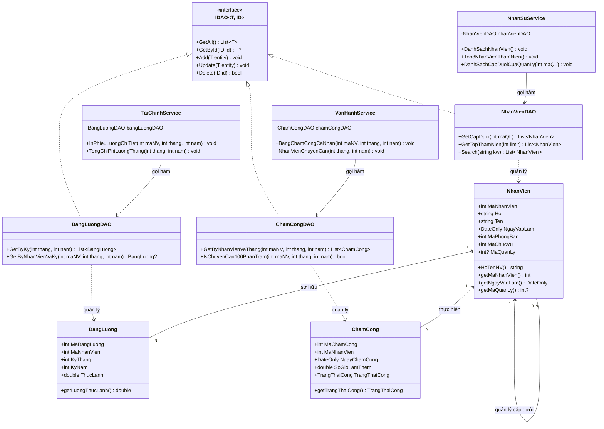

# HRM & TASK MANAGEMENT SYSTEM - PHIÊN BẢN C# (.NET 10)

> Hệ thống Thông tin Quản trị Nhân sự và Vận hành Công việc doanh nghiệp, được xây dựng hoàn toàn bằng ngôn ngữ **C# (.NET 10)**, áp dụng triệt để kiến trúc phân tầng Hướng đối tượng (OOP) 3 lớp và sức mạnh của **LINQ (Language-Integrated Query) & Lambdas** để xử lý 30 câu truy vấn dữ liệu phức tạp.

---

##  Mục lục
- [Giới thiệu](#-giới-thiệu)
- [Tính năng chính](#-tính-năng-chính)
- [Áp dụng lập trình hướng đối tượng (OOP)](#-áp-dụng-lập-trình-hướng-đối-tượng-oop)
- [Kiến trúc & Sơ đồ lớp (Class Diagram)](#-kiến-trúc--sơ-đồ-lớp-class-diagram)
- [Yêu cầu hệ thống & Công nghệ sử dụng](#-yêu-cầu-hệ-thống--công-nghệ-sử-dụng)
- [Hướng dẫn cài đặt & Chạy chương trình](#-hướng-dẫn-cài-đặt--chạy-chương-trình)
- [Tác giả](#-tác-giả)

---

##  Giới thiệu

Trong các doanh nghiệp hiện đại, nguồn nhân lực là tài sản cốt lõi quyết định năng lực cạnh tranh. Tuy nhiên, công tác quản trị nhân sự truyền thống thông qua sổ sách hoặc các bảng tính rời rạc (Excel) bộc lộ nhiều điểm nghẽn nghiêm trọng:
* Dữ liệu chấm công thủ công phân tán, dễ sai sót và khó kiểm soát giờ làm việc thực tế.
* Hợp đồng lao động hết hạn không được cảnh báo kịp thời, dẫn tới rủi ro pháp lý cho doanh nghiệp.
* Quy trình tính lương phức tạp (kết hợp lương cơ bản, phụ cấp trách nhiệm, thưởng làm thêm ngoài giờ OT và các khoản trích nộp bảo hiểm bắt buộc BHXH 10.5%).
* Đánh giá hiệu suất nhân viên (KPI) thiếu minh bạch và không có trọng số đo lường định lượng.

**Hệ thống Quản trị Nhân sự và Công việc (HRM & Task Management System - C# Edition)** được xây dựng nhằm giải quyết triệt để các bài toán trên. Ứng dụng thiết lập cơ sở dữ liệu mô phỏng trong bộ nhớ gồm 14 thực thể và 10 danh mục Enumeration đạt dạng chuẩn 3NF/BCNF, chia thành 3 phân hệ nghiệp vụ độc lập nhưng liên kết chặt chẽ, đồng thời hiện thực hóa 30 chức năng truy vấn báo cáo chuyên sâu bằng công nghệ **C# LINQ & Lambdas (.NET 10)**.

---

##  Tính năng chính

Hệ thống cung cấp đầy đủ 30 chức năng nghiệp vụ được phân rã thành 3 phân hệ chuyên trách trong C#:

### 1. Phân hệ Quản trị Nhân sự & Tổ chức (Thành viên 1: Đặng Hoàng Lĩnh)
- **Hồ sơ nhân viên 360° (Câu 1):** Quản lý tập trung thông tin cá nhân, liên lạc, chức danh và phòng ban.
- **Sơ đồ cơ cấu tổ chức (Câu 2):** Thống kê quy mô nhân sự trực thuộc từng phòng ban và nhận diện chức vụ trưởng phòng.
- **Tra cứu đa dạng (Câu 3):** Tra cứu nhân sự theo mã hoặc từ khóa tên phòng ban (dùng `Equals(..., StringComparison.OrdinalIgnoreCase)`).
- **Vinh danh thâm niên (Câu 4):** Tự động sắp xếp và trích xuất Top 3 nhân viên bằng LINQ `.OrderBy().Take(3)`.
- **Cây phân cấp quản trị (Câu 5):** Truy vết chính xác quan hệ cấp trên – cấp dưới trực tiếp thông qua quan hệ tự tham chiếu (`maQuanLy.HasValue`).
- **Quản lý ban dự án (Câu 6):** Hiển thị chi tiết nhóm dự án, danh sách thành viên, ngày tham gia và vai trò.
- **Thống kê nhân sự đa nhiệm (Câu 7):** Gom nhóm bằng LINQ `.GroupBy()` để phát hiện các nhân sự tham gia từ 2 nhóm dự án trở lên.
- **Cân đối vị trí nghề nghiệp (Câu 8):** Đếm số lượng nhân sự nắm giữ từng vị trí chức vụ bằng `.Count()`.
- **Quản lý tài nguyên nhàn rỗi (Câu 9):** Lọc danh sách nhân viên mới hoặc chưa tham gia bất kỳ nhóm dự án nào.
- **Tìm kiếm thông minh (Câu 10):** 1 từ khóa duy nhất tìm kiếm đồng thời theo Họ tên, Số điện thoại hoặc Email bằng `.Where().Contains()`.

### 2. Phân hệ Vận hành & Quản lý Chấm công (Thành viên 2: Nguyễn Sinh Dương)
- **Hợp đồng & Pháp lý (Câu 11):** Bản in chi tiết hợp đồng lao động và danh mục điều khoản pháp lý đính kèm.
- **Cảnh báo đáo hạn tự động (Câu 12):** Tự động rà soát và cảnh báo hợp đồng sắp hết hạn trong vòng 30 ngày bằng `DateOnly.DayNumber`.
- **Lịch sử chấm công tháng (Câu 13):** Bảng quẹt thẻ chi tiết từng ngày công: giờ vào, giờ ra, trạng thái công và số giờ OT.
- **Xếp hạng kỷ luật (Câu 14):** Gom nhóm và xếp hạng Top nhân viên vi phạm đi trễ (`DI_TRE`) nhiều nhất trong tháng bằng `.GroupBy().OrderByDescending()`.
- **Ghi nhận cống hiến OT (Câu 15):** Thống kê Top nhân viên làm thêm giờ nhiều nhất trong tháng bằng LINQ `.Sum()`.
- **Quy trình phê duyệt nghỉ phép (Câu 16):** Lọc danh sách các đơn xin nghỉ phép đang ở trạng thái `CHO_DUYET`.
- **Hồ sơ nghỉ phép cá nhân (Câu 17):** Truy xuất toàn bộ lịch sử nghỉ phép trong năm của một nhân sự.
- **Tôn vinh chuyên cần 100% (Câu 18):** Tìm kiếm các nhân viên đi làm đầy đủ, không trễ/vắng trong tháng bằng `.All()`.
- **Thống kê loại hợp đồng (Câu 19):** Phân tích tỷ trọng cơ cấu hợp đồng lao động theo `Enum.GetValues<LoaiHopDong>()`.
- **Thanh tra pháp chế (Câu 20):** Lọc toàn bộ các điều khoản thuộc nhóm Bảo mật thông tin hoặc Kỷ luật lao động.

### 3. Phân hệ Quản lý Tài chính, Tiền lương & KPI (Thành viên 3: Nguyễn Gia Hạo)
- **Phiếu lương minh bạch (Câu 21):** Xuất phiếu lương cá nhân (Payslip) gồm đầy đủ các dòng hạch toán cộng (Gross) và trừ (Khấu trừ).
- **Tổng ngân sách lương tháng (Câu 22):** Tính toán tổng số tiền lương toàn công ty phải chi trả bằng LINQ `.Sum(b => b.getLuongThucLanh())`.
- **Quỹ lương theo phòng ban (Câu 23):** Thống kê tổng chi phí lương thực lãnh đã giải ngân theo từng phòng ban.
- **Vinh danh thu nhập cao (Câu 24):** Sắp xếp giảm dần và lọc Top 3 nhân sự có thu nhập thực lãnh cao nhất bằng `.OrderByDescending().Take(3)`.
- **Bóc tách bảo hiểm bắt buộc (Câu 25):** Thống kê chi tiết số tiền trích nộp các quỹ BHXH, BHYT, BHTN.
- **Báo cáo danh mục phụ cấp & thưởng (Câu 26):** Tổng hợp toàn bộ các khoản mục tiền thưởng và phụ cấp đã chi trả.
- **Phiếu KPI đa tiêu chí (Câu 27):** Bản in phiếu đánh giá hiệu suất gồm điểm tổng kết, xếp loại và chi tiết từng tiêu chí có trọng số.
- **Phân loại thi đua cuối năm (Câu 28):** Gom nhóm nhân sự theo 4 mức xếp loại: Xuất sắc, Tốt, Trung bình, Yếu bằng `.GroupBy()`.
- **Chiến sĩ thi đua toàn diện (Câu 29):** Lọc nhân sự đạt KPI Xuất Sắc VÀ không có bất kỳ ngày nghỉ phép nào trong năm.
- **Khảo sát đãi ngộ thị trường (Câu 30):** Tính thu nhập bình quân theo từng chức vụ bằng LINQ `.Average()`.

---

## Áp dụng lập trình hướng đối tượng (OOP)

Ứng dụng C# tuân thủ nghiêm ngặt 4 nguyên lý OOP và các mẫu thiết kế kiến trúc chuẩn mực:

### 1. Đóng gói (Encapsulation)
- Toàn bộ 14 lớp Model trong namespace `com.hrmis.models` đều áp dụng chuẩn thuộc tính tự động của C# (**Auto-Properties** `{ get; set; }`).
- Dữ liệu được bảo vệ an toàn, kiểm soát truy cập thông qua các thuộc tính PascalCase và các phương thức nghiệp vụ.
- Hỗ trợ các phương thức cầu nối tương thích (Bridge methods) như `HoTenNV()`, `getMaNhanVien()` giúp giữ nguyên tính đồng bộ thuật toán với Java.

### 2. Trừu tượng (Abstraction)
- Định nghĩa giao diện tổng quát `IDAO<T, ID>` trong namespace `com.hrmis.dao`, trừu tượng hóa các hành vi CRUD cơ bản (`GetAll()`, `GetById()`, `Add()`, `Update()`, `Delete()`).
- Tầng Service chỉ tương tác với các hành vi trừu tượng mà không cần quan tâm dữ liệu bên dưới được lưu trữ trong danh sách tĩnh (`DatabaseMock`) hay Cơ sở dữ liệu quan hệ (SQL Server qua Entity Framework Core).
- Ứng dụng các delegate trừu tượng hóa hành vi tính toán như `Func<T, TResult>`, `Action<T>`, `Predicate<T>`.

### 3. Kế thừa (Inheritance)
- Toàn bộ 14 lớp DAO cụ thể (`NhanVienDAO`, `PhongBanDAO`, `BangLuongDAO`...) đều kế thừa giao diện cơ sở `IDAO<T, ID>`:
  ```csharp
  public class NhanVienDAO : IDAO<NhanVien, int> { ... }
  ```
- Đảm bảo tính nhất quán trong toàn bộ tầng truy xuất dữ liệu, giúp dễ dàng tái sử dụng và mở rộng hệ thống.

### 4. Đa hình (Polymorphism)
- **Ghi đè phương thức (Method Overriding):** 
  - Các lớp Model ghi đè phương thức `ToString()` để phục vụ việc in vết và gỡ lỗi.
  - Các lớp DAO triển khai và ghi đè các hàm của `IDAO<T, ID>` theo logic xử lý riêng của từng thực thể.
- **Đa hình giao diện (Interface-based Polymorphism):** 
  - Khai báo biến dưới dạng kiểu interface: `IDAO<NhanVien, int> dao = new NhanVienDAO();`.
- **Đa hình tham số (Parametric Polymorphism / Generics):**
  - Giao diện `IDAO<T, ID>` hoạt động linh hoạt với mọi thực thể `T` và kiểu khóa chính `ID` khác nhau (`int`, `CompositeKey`).

### 5. Design Patterns đã áp dụng
* **Data Access Object (DAO) Pattern:** Đóng vai trò là tầng trung gian duy nhất giao tiếp với nguồn dữ liệu. Tách biệt hoàn toàn mã nguồn xử lý nghiệp vụ (`*Service`) khỏi mã nguồn truy xuất dữ liệu (`*DAO`), đạt chuẩn **Khớp nối lỏng lẻo (Loose Coupling)** và **Đơn trách nhiệm (Single Responsibility Principle)**.
* **Strategy Pattern:** Ứng dụng thông qua biểu thức Lambda (`=>`) và LINQ Extension Methods cho phép hoán đổi thuật toán sắp xếp hoặc lọc linh hoạt ngay tại thời điểm chạy.
* **3-Layer Architecture Pattern:** Phân chia kiến trúc rõ ràng: *Presentation Layer (Program.cs) -> Service Layer -> DAO Layer -> Mock Database*.

---

##  Kiến trúc & Sơ đồ lớp (Class Diagram)

### 1. Kiến trúc phân tầng C#
```
+--------------------------------------------------------------------------+
|                     TẦNG TRÌNH DIỄN (PRESENTATION)                       |
|                             Program.cs                                   |
|        (Menu Console tương tác điều hướng 30 câu hỏi truy vấn)           |
+--------------------------------------------------------------------------+
                                     |
                                     v
+--------------------------------------------------------------------------+
|                     TẦNG DỊCH VỤ (SERVICE LAYER)                         |
|   - NhanSuService.cs                    (Đặng Hoàng Lĩnh: Câu 1 -> 10)   |
|   - VanHanhService.cs                   (Nguyễn Sinh Dương: Câu 11 -> 20)|
|   - TaiChinhService.cs                  (Nguyễn Gia Hạo: Câu 21 -> 30)   |
+--------------------------------------------------------------------------+
                                     |
                                     v
+--------------------------------------------------------------------------+
|                TẦNG TRUY XUẤT DỮ LIỆU (DAO LAYER - IDAO<T, ID>)          |
|    NhanVienDAO, PhongBanDAO, HopDongDAO, ChamCongDAO, BangLuongDAO...    |
+--------------------------------------------------------------------------+
                                     |
                                     v
+--------------------------------------------------------------------------+
|                     TẦNG LƯU TRỮ (DATABASE MOCK)                         |
|                       com.hrmis.data.DatabaseMock                        |
|            (14 danh sách List<T> thực thể dữ liệu mẫu chuẩn 3NF)         |
+--------------------------------------------------------------------------+
```

### 2. Sơ đồ lớp Mermaid (C# Edition)



---

##  Yêu cầu hệ thống & Công nghệ sử dụng

### 1. Môi trường yêu cầu
- **.NET SDK:** **.NET SDK 10.0** (hoặc tương thích với .NET 8.0 / 9.0).
- **Hệ điều hành:** Microsoft Windows 10/11, macOS hoặc Linux.
- **RAM:** Tối thiểu 4GB RAM.

### 2. Công nghệ C# áp dụng
* **Ngôn ngữ C# 10 / .NET 10.**
* **LINQ (Language-Integrated Query):** Cú pháp Extension Method cực kỳ mạnh mẽ: `.Where()`, `.Select()`, `.GroupBy()`, `.OrderBy()`, `.OrderByDescending()`, `.Take()`, `.Sum()`, `.Average()`, `.Count()`, `.All()`, `.Any()`.
* **Biểu thức Lambda (`=>` - Fat Arrow):** Biểu diễn hàm ngắn gọn, súc tích.
* **Toán tử an toàn:** Null-conditional (`?.`), Null-coalescing (`??`), Nullable Value Types (`int?`).
* **Kiểu dữ liệu thời gian hiện đại:** `System.DateOnly`, `System.TimeOnly`.
* **Cơ chế Deferred Execution:** Tối ưu hóa hiệu năng xử lý truy vấn dữ liệu theo nhu cầu.

---

## Hướng dẫn cài đặt & Chạy chương trình

1. Mở cửa sổ dòng lệnh (Terminal / Command Prompt / PowerShell) và điều hướng vào thư mục dự án C#:
   ```bash
   cd "liên kết folder OOP_HRM-TaskManagement_C-Sharp"
   ```
2. Khởi chạy trực tiếp chương trình bằng lệnh `dotnet run`:
   ```bash
   dotnet run
   ```
3. Khi menu console xuất hiện, nhập số thứ tự câu hỏi từ `1` đến `30` để xem kết quả truy vấn, hoặc nhập `0` để thoát.

---

## Tác giả

Đồ án được thực hiện bởi nhóm sinh viên Khoa Công Nghệ Thông Tin dưới sự hướng dẫn khoa học của:
* **Giảng viên hướng dẫn:** Thầy Nguyễn Minh Đạo

### Thành viên nhóm thực hiện:
1. **Đặng Hoàng Lĩnh** – **MSSV: 25162073** (Phân hệ 1: Quản trị Nhân sự & Tổ chức — Câu 1 -> 10).
2. **Nguyễn Sinh Dương** – **MSSV: 25162019** (Phân hệ 2: Vận hành & Chấm công — Câu 11 -> 20).
3. **Nguyễn Gia Hạo** – **MSSV: 25162030** (Phân hệ 3: Tài chính, Tiền lương & KPI — Câu 21 -> 30).
